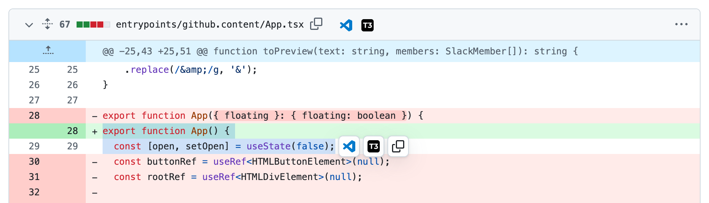
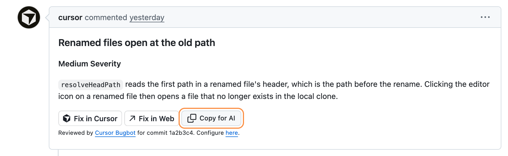
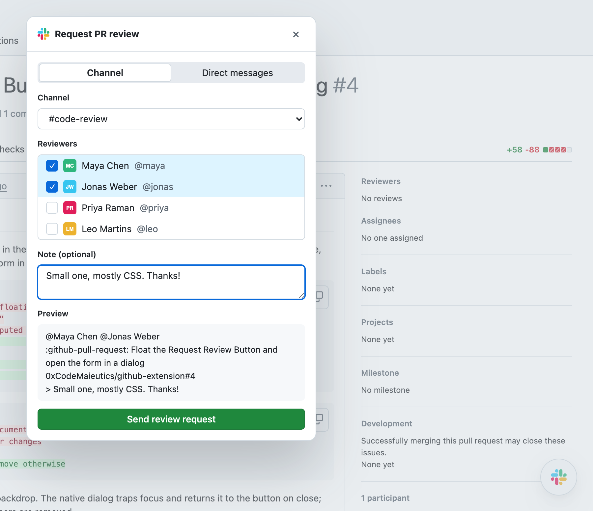
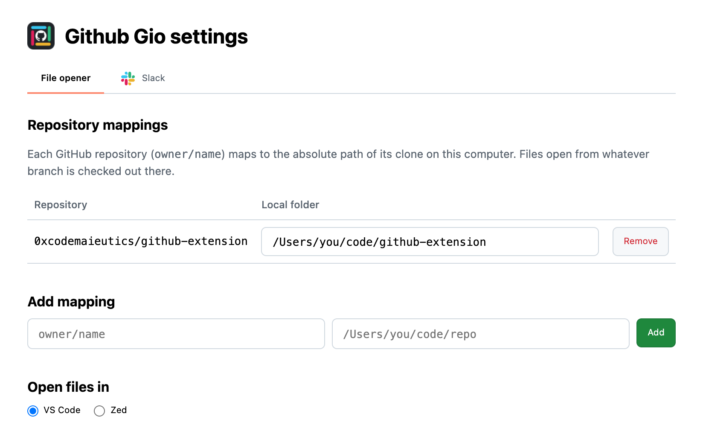
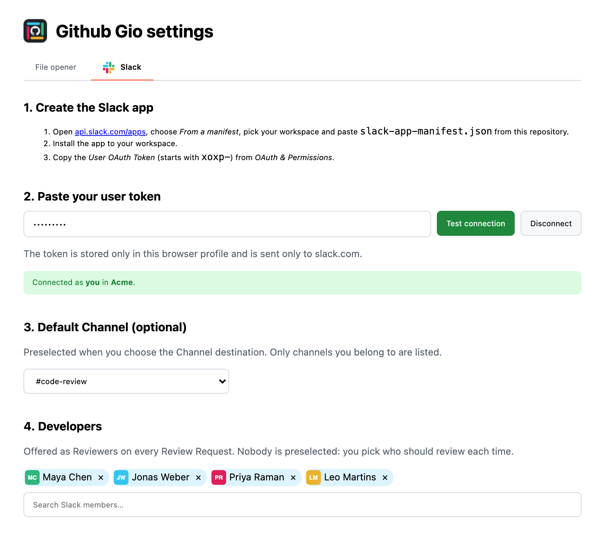

# Github Extension

A Chromium extension (Chrome, Edge, Brave, Arc) for GitHub.com pull requests with two features.

### File opener: jump from a diff to your editor or T3 Code

<picture>
  <source media="(prefers-color-scheme: dark)" srcset="docs/screenshots/file-opener-dark.png">
  
</picture>

**Problem:** GitHub's diff view only shows a few lines around each change. For a proper review you want the code in your IDE, with go-to-definition, the rest of the file and a terminal. Getting there is slow: switch to the editor, open the right repository, search for the file, then scroll to the line you were reading. Asking an AI agent about a snippet is just as slow, because you copy the code, the path and the line numbers into a chat by hand.

**Solution:** One click from the diff.

- Click the editor icon on a file header and the file opens in VS Code or Zed at its first changed line.
- Select lines in the diff and a small toolbar appears beside them. It opens the file in your editor at those lines, starts a T3 Code chat that references them, or copies them as a ready-to-paste prompt with the PR, file path and line numbers.
- Cursor Bugbot comments get a **Copy for AI** button, so you can hand a finding to an agent in one step.

<picture>
  <source media="(prefers-color-scheme: dark)" srcset="docs/screenshots/bugbot-dark.png">
  
</picture>

### Slack: request a review without leaving the PR

<p align="center">
<picture>
  <source media="(prefers-color-scheme: dark)" srcset="docs/screenshots/slack-dialog-dark.png">
  
</picture>
</p>

**Problem:** Opening a PR is only half the job. Someone still has to review it, so you copy the PR link, switch to Slack, find the review channel or each teammate's DMs, type out the title and a note, and @-mention people one by one. Asking three people this way can take a few minutes, and the message looks different every time.

**Solution:** A **Request PR review** button with a Slack icon floats on open pull requests.

- Click it, tick the Reviewers, add an optional note and send.
- The extension posts the Review Request to Slack as you. It goes either as one channel message that mentions every Reviewer, or as a separate direct message to each one.
- The PR title and link are filled in for you, and the dialog previews the message before you send it.

Click the toolbar icon to open the settings. Each feature has its own tab.

See [CONTEXT.md](./CONTEXT.md) for the project's vocabulary, [docs/adr/](./docs/adr/) for the file opener's decisions and [docs/file-opener-handoff.md](./docs/file-opener-handoff.md) for its product notes.

## Install

```sh
pnpm install
pnpm build
```

Open `chrome://extensions`, turn on *Developer mode*, click *Load unpacked* and choose `.output/chrome-mv3`.

## File opener

1. Open a pull request's Files changed tab (`/pull/<n>/files` or `/pull/<n>/changes`).
2. Click the editor icon next to a file name.
3. The first time for a repository, type the absolute path to your local clone (e.g. `/Users/you/code/repo`). It is saved per `owner/name`.
4. The editor opens the file at the first changed line (line 1 when no change can be read, e.g. binary or collapsed diffs).

- **Alt/Option-click** the icon to change the saved folder for that repository.
- The *File opener* tab lists, edits and removes mappings, and picks the editor: **VS Code** (default) or **Zed**. The icons switch to match.
- Deleted files get no icon. Renamed files open at their new path.
- The extension never switches branches: the file opens from whatever is checked out locally, so its content may differ from the PR until you check out the PR branch yourself.

The *File opener* settings tab:

<picture>
  <source media="(prefers-color-scheme: dark)" srcset="docs/screenshots/settings-file-opener-dark.png">
  
</picture>

File paths are verified against GitHub's `diff-<sha256(path)>` anchor ids, which both the classic and the newer React diff UI use.

## Slack

1. **Create the Slack app.** Go to [api.slack.com/apps](https://api.slack.com/apps?new_app=1), choose *From a manifest*, pick your workspace and paste [`slack-app-manifest.json`](./slack-app-manifest.json). Under *Basic Information → Display Information*, upload [`assets/slack-app-icon.png`](./assets/slack-app-icon.png) as the app icon. Install the app, then copy the *User OAuth Token* (`xoxp-…`) from *OAuth & Permissions*.
2. **Connect the extension.** On the *Slack* tab of the settings, paste the token, click *Save & test*, add the Developers you request reviews from, and optionally choose a Default Channel.

The *Slack* settings tab, connected:

<picture>
  <source media="(prefers-color-scheme: dark)" srcset="docs/screenshots/settings-slack-dark.png">
  
</picture>

The token is stored with `chrome.storage.local` in this browser profile only. Only the background worker reads it and sends it to slack.com, so GitHub's page never sees it. The extension keeps no history of the Review Requests you send.

The button floats in the bottom-right corner of the PR Page, independent of GitHub's classic and React pull request headers. Clicking it opens the Review Request form in a dialog.

### Slack scopes

The manifest requests these user scopes:

| Scope | Used for |
| --- | --- |
| `chat:write` | Posting the Review Request as you |
| `users:read` | Searching Slack members to add as Developers |
| `channels:read`, `groups:read` | Listing the public and private channels you belong to |
| `im:write` | Opening a direct message with each Reviewer |

## Develop

```sh
pnpm dev       # launches Chromium with the extension and reloads on change
pnpm compile   # type-check
pnpm test      # unit tests (Vitest + happy-dom) for the file opener
pnpm zip       # package for the Chrome Web Store
pnpm screenshots  # after pnpm build (and `pnpm exec playwright install chromium` once): regenerate docs/screenshots
```

Layout:

- `entrypoints/file-opener.content/`: file opener content script (header icons, selection affordance, mapping prompt, Bugbot button).
- `entrypoints/slack.content/`: Request Review Button and dialog.
- `entrypoints/options/`: tabbed settings page.
- `entrypoints/background.ts`: Slack API calls and opening the settings.
- `lib/file-opener/`: GitHub URL parsing, file and path detection, diff anchors, storage, `vscode://` / `zed://` URLs.
- `lib/`: Slack API client, settings and messaging.
- `scripts/screenshots.mjs`: loads the built extension in Playwright's Chromium on this repository's PR #4 with a faked Slack API, and captures the README screenshots.
