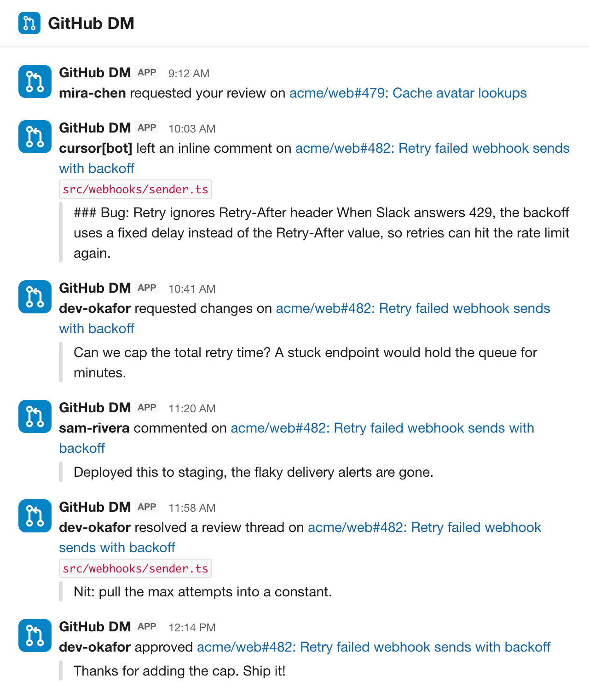
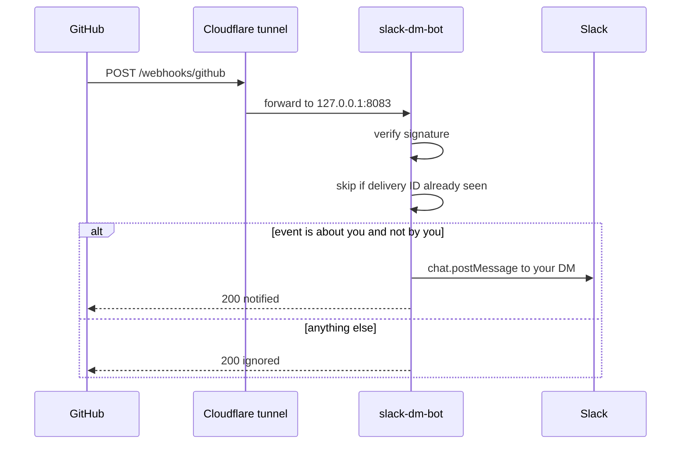

# slack-dm-bot

A small single-user bot that turns GitHub webhooks into Slack DMs. One Python service (stdlib only), SQLite for delivery dedupe.

You get a DM when:

- someone **requests your review** on a PR
- someone **submits a review** (approve, request changes, or comment with a summary) on a PR you opened
- someone leaves a **top-level comment** on a PR you opened
- someone leaves an **inline comment** on a PR you opened. This includes Cursor Bugbot findings. A Bugbot-style review with an empty summary is skipped because each of its inline comments is sent as its own DM.
- someone **resolves or unresolves a review thread** on a PR you opened

Your own activity is skipped. Each DM has the actor, the PR title linked to the specific review or comment, the file path for inline comments, and a short excerpt.

<picture>
  <source media="(prefers-color-scheme: dark)" srcset="docs/screenshots/dms-dark.png">
  
</picture>

## How it works



## Setup

1. **Slack app**: at <https://api.slack.com/apps>, choose *Create New App → Paste a manifest*, pick your workspace, and paste `slack-app-manifest.yaml`. Then click *Install to Workspace* and copy the *Bot User OAuth Token* (`xoxb-…`) from *OAuth & Permissions*. Get your member ID from your Slack profile: *⋮ → Copy member ID*.
2. **Configure**:
   ```sh
   cp .env.example .env
   openssl rand -hex 32   # use as GITHUB_WEBHOOK_SECRET
   ```
   Fill in all four values in `.env`.
3. **Run**:
   ```sh
   docker compose up -d --build
   curl http://127.0.0.1:8083/healthz   # -> ok
   ```
   The service listens only on `127.0.0.1:8083`. The existing Cloudflare tunnel must forward to `http://127.0.0.1:8083`.
4. **GitHub webhook**: add it on each repo (or org) under *Settings → Webhooks → Add webhook*:
   - Payload URL: `https://sense-indicators-powers-emerging.trycloudflare.com/webhooks/github`
   - Content type: `application/json`
   - Secret: your `GITHUB_WEBHOOK_SECRET`
   - Events: *Let me select individual events* → **Pull requests**, **Pull request reviews**, **Pull request review comments**, **Pull request review threads**, **Issue comments**

   GitHub sends a `ping` when you save. Under *Recent Deliveries* it should show `200 pong`.

Note: `trycloudflare.com` quick-tunnel URLs change whenever `cloudflared` restarts. If that happens, update the webhook's Payload URL.

## Manual smoke check

Run the unit tests (no Docker needed):

```sh
python3 -m unittest -v
```

With the container running, send a signed fake PR comment through the tunnel. You should get a Slack DM:

```sh
set -a; . ./.env; set +a
URL=https://sense-indicators-powers-emerging.trycloudflare.com/webhooks/github
BODY=$(cat <<JSON
{"action":"created","sender":{"login":"smoke-tester"},
 "repository":{"full_name":"example/repo"},
 "issue":{"number":1,"title":"Smoke test","html_url":"https://github.com/example/repo/pull/1",
          "user":{"login":"$GITHUB_USERNAME"},"pull_request":{}},
 "comment":{"user":{"login":"smoke-tester"},"body":"Hello from the smoke check",
            "html_url":"https://github.com/example/repo/pull/1#issuecomment-1"}}
JSON
)
SIG=$(printf '%s' "$BODY" | openssl dgst -sha256 -hmac "$GITHUB_WEBHOOK_SECRET" | sed 's/^.* //')
DELIVERY=smoke-$(date +%s)

curl -sS -X POST "$URL" -H 'Content-Type: application/json' \
  -H 'X-GitHub-Event: issue_comment' -H "X-GitHub-Delivery: $DELIVERY" \
  -H "X-Hub-Signature-256: sha256=$SIG" --data-binary "$BODY"
# -> notified (and a DM arrives)

# Same delivery ID again -> duplicate (no second DM)
curl -sS -X POST "$URL" -H 'Content-Type: application/json' \
  -H 'X-GitHub-Event: issue_comment' -H "X-GitHub-Delivery: $DELIVERY" \
  -H "X-Hub-Signature-256: sha256=$SIG" --data-binary "$BODY"

# Bad signature -> 401 invalid signature
curl -sS -X POST "$URL" -H 'X-GitHub-Event: ping' -H 'X-GitHub-Delivery: x' \
  -H 'X-Hub-Signature-256: sha256=00' --data-binary '{}'
```

To smoke-test locally without the tunnel, use `URL=http://127.0.0.1:8083/webhooks/github`. Use `docker compose logs -f` to see each delivery's decision (`notified`, `ignored`, `duplicate`, or a Slack error).

## Behavior notes

- **Responses**: `401` for a bad signature, `502` if Slack rejects the message, otherwise `200` with `notified`, `ignored`, `duplicate`, or `pong`.
- **Retries**: if the Slack send fails, the delivery isn't recorded. Use *Redeliver* in GitHub to retry it.
- **Dedupe**: delivery IDs are kept for 30 days in the `deliveries` Docker volume.
- **Team requests**: review requests sent to a team, not to you directly, are ignored.
